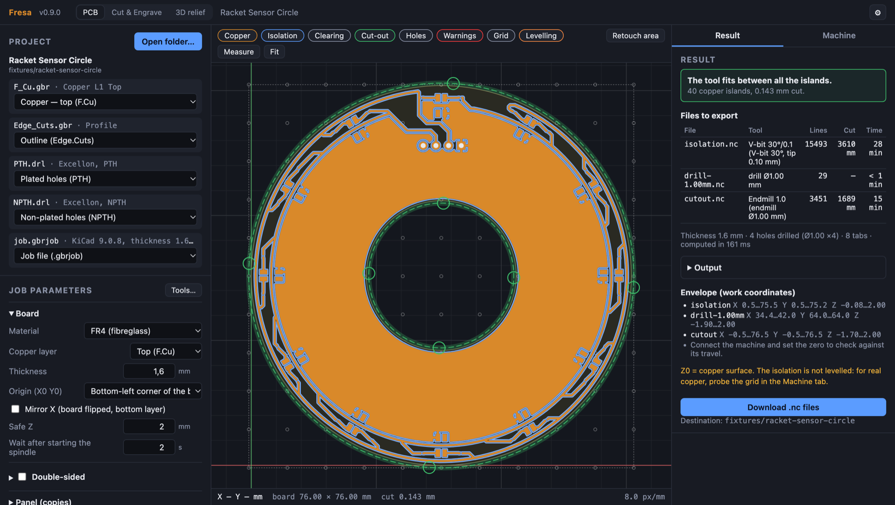
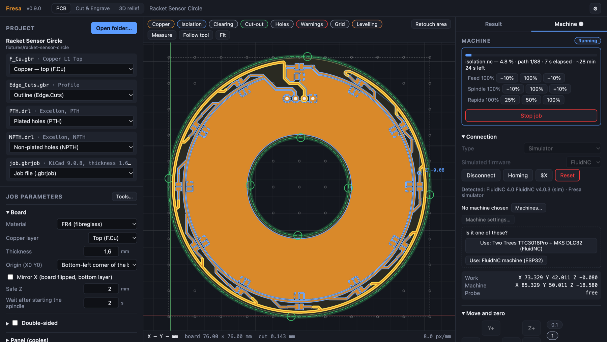
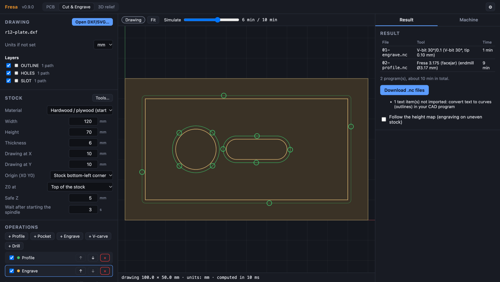
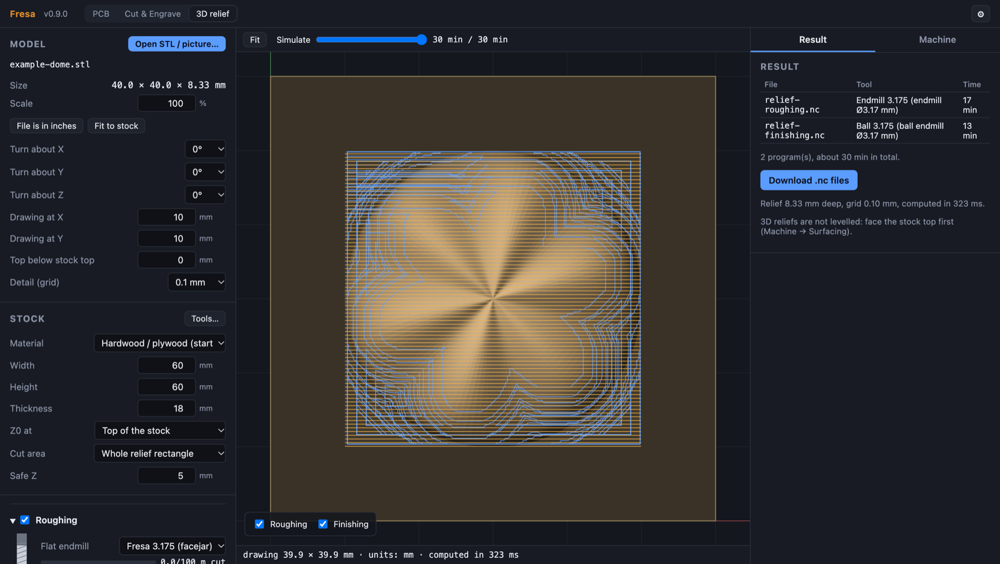

<h1 align="center">Fresa</h1>

  <strong>CAM e controlo de máquina para fresadoras CNC amadoras.</strong> 
  Fresar PCBs que funcionam mesmo numa 3018 barata, cortar e gravar a partir de DXF/SVG, esculpir relevos 3D
  a partir de STL e imagens — tudo numa só aplicação que fala com GRBL, grblHAL, FluidNC e Marlin.

  
  
  
  

  <a href="../../releases/latest"><b>⬇ Descarregar</b></a> ·
  <a href="docs/guide/pt/README.md"><b>Guia do utilizador</b></a> ·
  <a href="docs/guide/en/README.md">Guide in English</a> ·
  <a href="../../issues">Reportar um problema</a>

## Porquê o Fresa

Fresar uma PCB numa máquina amadora falha por razões aborrecidas: a placa está 0,2 mm
empenada e um V-bit a 0,08 mm corta ar de um lado e atravessa o cobre do outro; dois
pads estão mais perto do que o corte e ficam em curto; o spindle tem excentricidade e o
sulco sai três vezes mais largo do que diz o catálogo. O Fresa nasceu exatamente numa
máquina dessas e lida com isso em vez de fingir que não acontece:

- **Mapa de alturas por sonda** — sonda uma grelha no cobre e todos os percursos seguem a
  superfície. Verifica o mapa, volta a sondar o Z nas trocas de ferramenta, retoca uma
  zona que saiu rasa.
- **Verificação de encaixe** — antes de cortar, o Fresa mostra onde o cobre está mais
  perto do que a largura do corte. Os intervalos estreitos levam um único corte a meio em
  vez de ficarem em curto.
- **Controlo real da máquina** — liga por USB ou rede, deteta o firmware, faz homing,
  desloca, zera, sonda; corre do cartão SD ou em streaming; posição, progresso e tempo
  restante ao vivo; para e retoma a meio do ficheiro ou no dia seguinte.
- **Um só caminho para tudo** — PCBs, corte/gravação 2D e relevos 3D partilham a mesma
  biblioteca de ferramentas, ligação à máquina, checklist e contador de desgaste.

## O que faz

| | |
|---|---|
| **PCB** — Gerber/Excellon do KiCad à entrada; isolação, furação, furos e ranhuras fresados, recorte com pontes, limpeza de cobre, painéis, dupla face com pinos de alinhamento, ficheiro único com pausas para troca de ferramenta. |  |
| **Máquina** — GRBL 1.1, grblHAL, FluidNC, Marlin. Deteção do firmware, biblioteca de máquinas, editor de definições com cópia de segurança, ajustes de avanço/spindle ao vivo, checklist antes de cortar, vista ao vivo. Simuladores dos quatro firmwares para experimentar tudo sem máquina. |  |
| **Corte e gravação** — DXF e SVG; contornos com pontes e rampas, caixas com ilhas, gravação, V-carve, furação; valores de partida para madeira, MDF, acrílico e alumínio; simulação antes de cortar. |  |
| **Relevo 3D** — modelos STL e imagens PNG/JPG; desbaste com fresa plana, acabamento com fresa esférica, pré-visualização sombreada. |  |

Interface e guia em **português europeu** e **inglês**.

## Instalar

Descarrega em **[Releases](../../releases/latest)**:

| Sistema | Ficheiro | Atualizações |
|---|---|---|
| macOS 11+ (Intel e Apple silicon) | `Fresa_<versão>_universal.dmg` | na aplicação |
| Windows 10/11 | `Fresa_<versão>_x64-setup.exe` (ou `.msi`) | na aplicação (setup.exe) |
| Linux | `Fresa_<versão>_amd64.AppImage` (ou `.deb`) | na aplicação (AppImage) |

O Fresa procura versões novas sozinho e instala-as com um clique (Definições →
Atualizações). As atualizações são assinadas; qualquer outra coisa é recusada.

**Primeira utilização**

- **macOS**: o Fresa não é assinado pela Apple. Abre-o uma vez, fecha o aviso e vai a
  Definições do Sistema → Privacidade e segurança → **Abrir mesmo assim**
  (ou `xattr -dr com.apple.quarantine /Applications/Fresa.app`).
- **Windows**: o SmartScreen pode dizer «O Windows protegeu o seu PC»: **Mais informações →
  Executar mesmo assim**.
- **Linux**: `chmod +x Fresa_*.AppImage` e executa-o. Para a porta série USB:
  `sudo usermod -aG dialout $USER`, e volta a iniciar a sessão.

## Primeiros passos

1. Abre a aplicação, escolhe **Simulador** no separador Máquina e carrega em Ligar: dá para
   experimentar tudo sem hardware.
2. Exporta as Gerbers do KiCad (Ficheiro → Saídas de fabrico) e **Abrir pasta…** no Fresa.
3. Lê [A primeira placa](docs/guide/pt/primeira-placa.md) — dez minutos, e cobre as coisas
   que estragam placas.

Guia completo: [Português](docs/guide/pt/README.md) · [English](docs/guide/en/README.md).

## A máquina onde nasceu

Uma Two Trees TTC3018Pro com uma MKS DLC32 a correr FluidNC, um V-bit de 30°, brocas de
1 mm, uma sonda de pinça crocodilo. Se funciona aí, funciona na maioria das máquinas da
classe 3018; máquinas maiores (Genmitsu 4040, LongMill, Shapeoko) estão na biblioteca de
máquinas.

## Opiniões e problemas

Encontraste um erro, tens uma placa que sai mal, tens uma máquina que o Fresa devia
conhecer? Abre um [issue](../../issues) — uma captura do separador Resultado e o registo
da consola (Máquina → Consola → Copiar) costumam chegar.

---

Este repositório contém as versões publicadas e a documentação. O código-fonte não é
público. © 2026 Fresa — os binários são gratuitos para descarregar e usar; ver [LICENSE](LICENSE).
